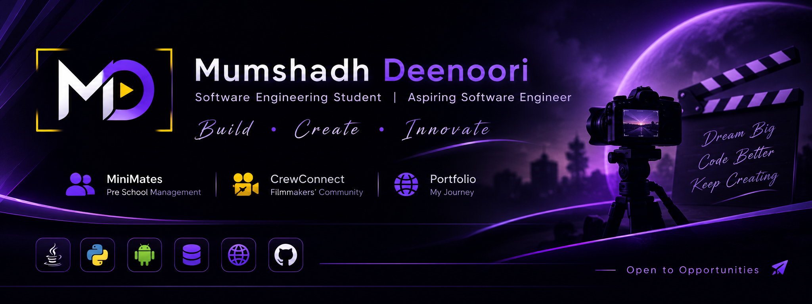

  

# Hi, I'm Mumshadh Deenoori 👋

<h2 align="center">ABOUT ME</h2>

  I'm a third-year <strong>Software Engineering undergraduate</strong>
  at the Open University of Sri Lanka.
    
  I'm interested in application development, database management,
  and networking. I enjoy building practical projects, exploring
  new technologies, and continuously improving my technical skills.

 

<h2 align="center">EDUCATION</h2>

  <strong>Bachelor of Software Engineering (Honours)</strong>
   
  The Open University of Sri Lanka
   
  <em>November 2023 – Present</em>

<h2 align="center">TECHNICAL SKILLS</h2>

<h3 align="center">Programming Languages</h3>

  

<h3 align="center">Development</h3>

  

<h3 align="center">Database & Tools</h3>

  

<h3 align="center">Networking</h3>

  <strong>Cisco Packet Tracer</strong> &nbsp; • &nbsp; <strong>MQTT</strong>

<h2 align="center">📊 GitHub Statistics</h2>

<h2 align="center">FEATURED PROJECTS</h2>

### 01 — CrewConnect
**Android Application · In Development**

An Android application designed to help aspiring filmmakers and creative professionals connect, collaborate, showcase their work, and discover creative opportunities.

 

### 02 — MiniMates
**Web Application · Academic Group Project**

A preschool management web application developed for Sussex College, Anuradhapura, as part of the Software Design in Group subject.

 

### 03 — Developer Portfolio
**React · JavaScript · Responsive Design**

My personal portfolio website, showcasing my background, technical skills, and software development projects.

 

### 🌱 Currently Working On

- Improving my React and JavaScript skills.
- Developing practical software engineering projects.
- Strengthening my database and networking knowledge.
- Preparing for a Software Engineering internship.

---

### 🤝 Connect With Me

- **LinkedIn:** [Mumshadh Deenoori](https://www.linkedin.com/in/mumshadh-deenoori-a26651315/)
- **GitHub:** [@Mumshadh](https://github.com/Mumshadh)
- **Portfolio:** [Visit My Website](https://mumshadh.github.io/mumshadh-portfolio/)

---

*Always learning, building, and improving.*
